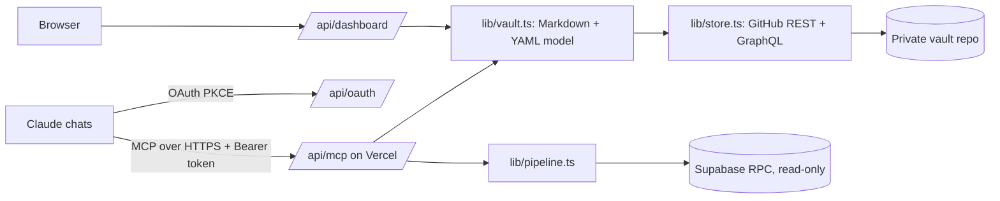

# hamoach

A remote MCP server that gives every Claude chat one shared memory of tasks, decisions and project status, stored as Markdown in a private GitHub repo.

## What it does

- Exposes 13 MCP tools over Streamable HTTP: `get_overview`, `get_project`, `list_tasks`, `search`, `add_task`, `complete_task`, `postpone_task`, `update_status`, `add_decision`, `log_chat_summary`, `save_meeting`, `set_calendar_event_id`, `get_pipeline`.
- Any Claude chat (web, desktop, phone) can read where a project stands and continue from there, and write back decisions, tasks and chat summaries.
- Every write is a single commit to the vault repo, so the full history is versioned and the vault stays readable in Obsidian.
- Single-user OAuth (PKCE + dynamic client registration) so it can be added as a custom connector in Claude.
- A password-protected dashboard page with overdue / this-week / open task counters and per-project status.
- Optional read-only `get_pipeline` tool that summarizes an outreach pipeline from a Supabase RPC (counts only, no contact details).

The vault itself (the personal notes) is a separate private repo and is not part of this code.

## Architecture



- `api/mcp.ts`: stateless MCP endpoint.
- `api/oauth.ts`, `lib/auth.ts`: OAuth metadata, registration, authorize, token. Tokens are signed JWTs; changing the access password revokes all of them.
- `lib/vault.ts`: the data model (status files, decision logs, task files, chat summaries, meetings).
- `lib/store.ts`: reads the vault with one tree listing plus batched blob fetches with retries; writes one commit per change. A local filesystem store is used for tests.
- `api/dashboard.ts`: server-rendered dashboard behind a signed cookie.

## Stack

TypeScript, Node 22, Vercel serverless functions, Model Context Protocol SDK, jose (JWT), zod, GitHub REST/GraphQL API, Supabase (optional).

## Run locally

```
npm install
cp .env.example .env    # fill in the values
npx tsx test/local-server.ts <path-to-a-vault-folder> [port]
```

Environment variables (set in Vercel, never committed):

| Name | Purpose |
| --- | --- |
| `GITHUB_TOKEN` | Fine-grained token scoped to the vault repo only, Contents read/write |
| `GITHUB_OWNER` | Owner of the vault repo |
| `GITHUB_REPO` | Vault repo name |
| `GITHUB_BRANCH` | Optional, defaults to `main` |
| `ACCESS_PASSWORD` | Login password for OAuth and the dashboard |
| `AUTH_SECRET` | Long random string used to sign tokens |
| `PUBLIC_URL` | Optional, public base URL of the deployment |
| `SUPABASE_URL` | Optional, for `get_pipeline` |
| `SUPABASE_PUBLISHABLE_KEY` | Optional, for `get_pipeline` |

## Tests

```
npm run typecheck
npx tsx test/run-tools.ts <vault-dir>       # every tool against a local folder, cleans up after itself
npx tsx test/run-tools.ts --github          # same against the real repo, using a throwaway test project
npx tsx test/oauth-flow.ts <vault-dir>      # 8-step OAuth + MCP over HTTP flow
npx tsx test/pipeline.ts <vault-dir> <n>    # get_pipeline (needs SUPABASE_* env)
```

The tool and OAuth suites expect the vault to contain a project named `LaBot 2.0`.

## How it was built

Built by directing AI coding agents (Claude Code); I own the spec, architecture, testing and deployment.
